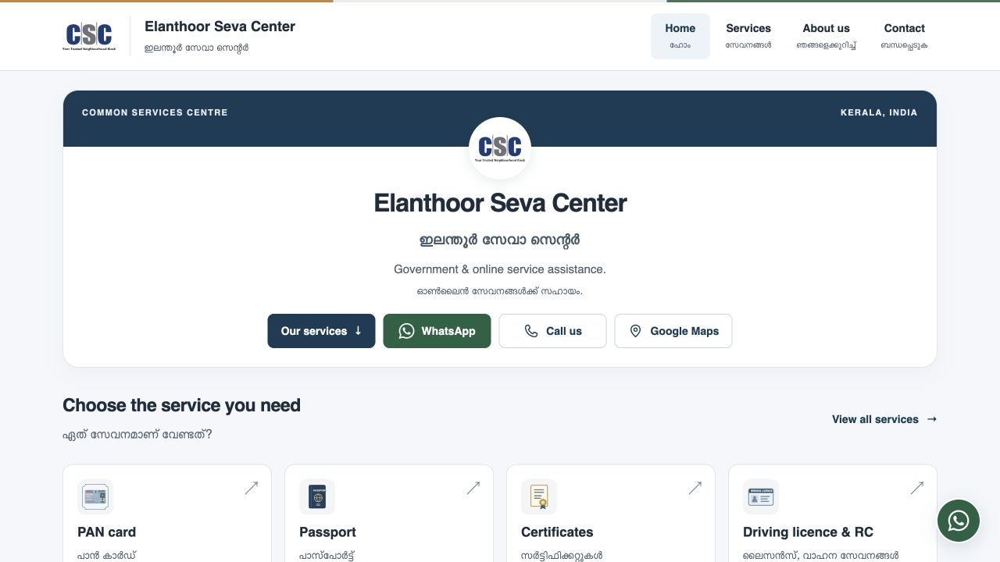

# Elanthoor Seva Center — Website Project

A responsive bilingual website I built for Elanthoor Seva Center, a local centre that helps people access CSC-related and other online services.

## Project highlights

- English and Malayalam content on the same website.
- A searchable service directory organised into categories.
- A guided WhatsApp enquiry flow and quick access to phone and maps.
- Layouts designed for phones, tablets and desktop computers.

**Built with:** Astro, TypeScript and CSS.

This repository is a portfolio overview. The production source code and client details are kept private. The screenshot is a presentation preview with contact details removed. This is not an official government website.
